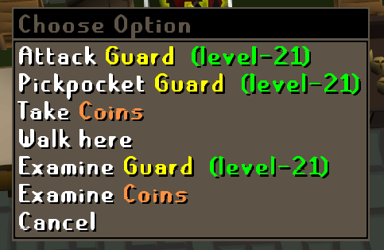
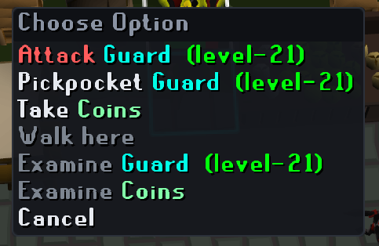
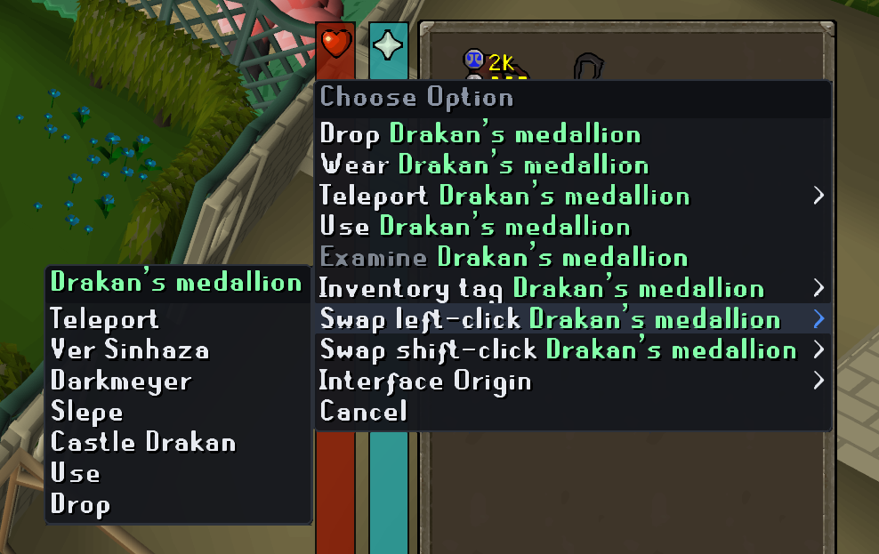

# Right Click Styler

Make RuneLite's right-click menus your own with themes, colours, fonts and hover effects. Right Click Styler also styles nested menus while keeping the game's menu layout and interactions.

| Without Right Click Styler | With Right Click Styler |
| -------------------------- | ----------------------- |
|  |  |

## Make it yours

- Start with **Dark**, **Midnight**, **Light**, **Glass** or **Classic**, then save your own themes.
- Set background, border, header, text, hover and accent colours. Choose a font, text size where supported, and text shadow.
- Adjust corner radius, border, drop shadow and header visibility. Choose a fill, bar, outline, text or no hover effect.
- Set **background opacity** and **hover opacity** separately to keep text readable over the game world.
- Highlight actions such as Attack, colour targets by type, and choose how combat levels are coloured.

Classic is the default theme. Changes to a theme appear immediately; save a custom theme to keep them after restarting RuneLite.

### Built-in themes

| Dark | Midnight | Light | Glass | Classic |
| :---: | :---: | :---: | :---: | :---: |
|  |  |  |  |  |

## Nested and scrollable menus

The plugin styles parent and child right-click menus, including the Menu Entry Swapper example below. It uses RuneLite's native menu width, rows and click regions, so hovering and selection remain normal. If a submenu frame cannot be verified, that frame uses the game's normal appearance.

See the [settings guide](docs/GUIDE.md) for the scrollable menu example and detailed controls.

## Installation and setup

1. In RuneLite, open the Plugin Hub, search for **Right Click Styler** and install it.
2. Open the Right Click Styler sidebar panel and select a built-in theme.
3. Expand a section to change its appearance. Use **Save as…** to keep edits to a built-in theme as a custom theme; use **Save** for later edits to that custom theme.

The **Show sidebar button** setting is in Right Click Styler's normal RuneLite configuration page. You can restore the button there if you hide it.

## Compatibility

Right Click Styler aims to preserve native menu geometry and interaction. In Custom target-colour mode, intentional inline colours from other menu entries are preserved where recognised. Some third-party menu additions may still use native styling.

If you use Interface Styles, turn off **High detail menu** and set **Menu alpha** to **255** to avoid conflicting menu draws. Exceptionally large menus may reduce FPS while open; normal-sized menus showed no measurable FPS difference in live Windows testing.

For every setting, theme sharing, RuneLite profiles and troubleshooting, read the [full settings guide](docs/GUIDE.md).

## License

BSD 2-Clause. See [LICENSE](LICENSE).
